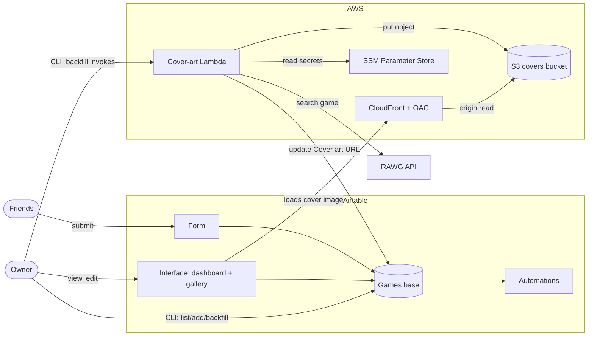
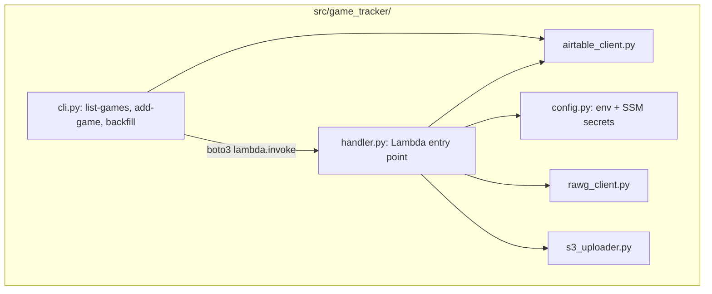
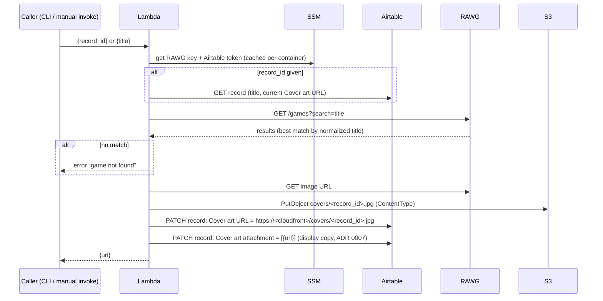
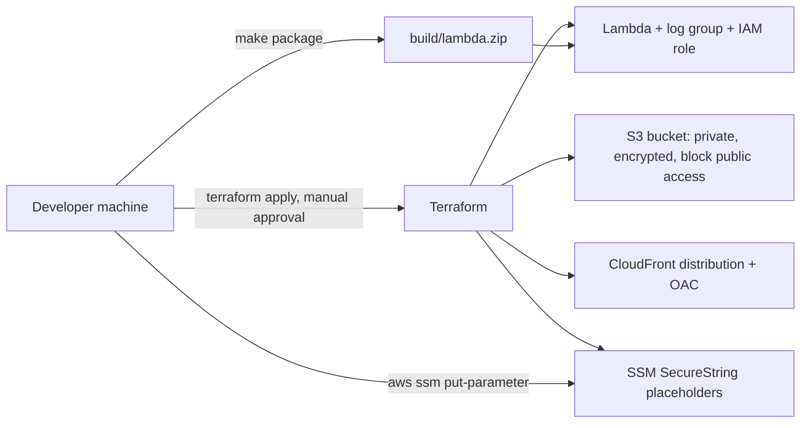

# Architecture: Game Collection Tracker

See the [PRD](prd.md) for requirements and [ADRs](adr/) for the reasoning behind each choice.

## 1. System context

## 2. Components

Each module has one external dependency, so each is unit-tested with that dependency mocked (`responses` for HTTP, `moto` for S3/SSM/Lambda).

## 3. Data flow: cover art for one game

Idempotency: the S3 key derives from the record id, so a re-run overwrites the same object and PATCHes the same URL. If the record already has the expected URL and the object exists, the handler returns early without calling RAWG.

## 4. Deployment

- IAM role: `s3:PutObject`/`GetObject`/`HeadObject` on `covers/*` only, `ssm:GetParameter` on `/game-tracker/*`, log writes to its own log group.
- The bucket policy allows reads only from this CloudFront distribution.
- Secret values are never in Terraform: parameters are created with a placeholder and `ignore_changes` on the value; the owner sets the real value with the AWS CLI.
